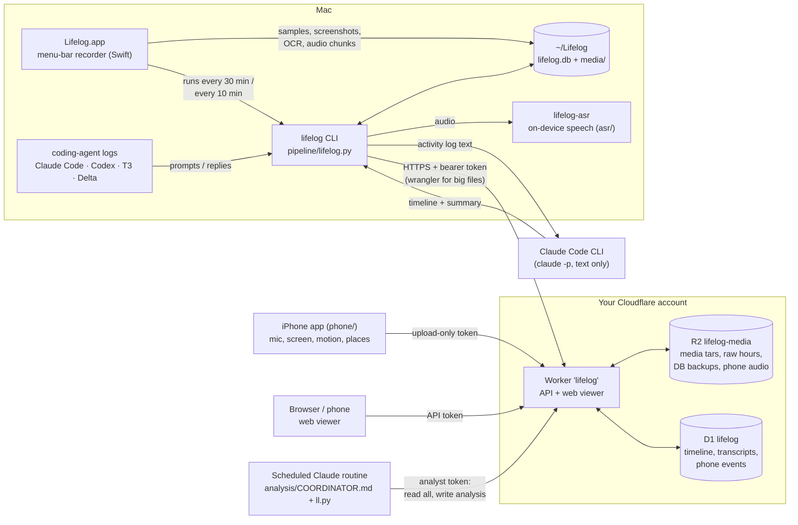

# Lifelog

Record everything first, figure out what happened later.

Lifelog is a personal, self-hosted lifelogging system for a Mac and an iPhone. A menu-bar app records the raw firehose
of your computer use: the frontmost app and window, input counts, screenshots, screen text and audio. On-device models
transcribe the audio and tell voices apart. Claude then turns it all into a timeline accurate to the second, like
"typed a prompt in T3 Code thread *lifelog app* for 3 min → 1 min reading/thinking → scrolled X for 6 min", plus a daily
summary. An optional iPhone app covers the time away from the laptop. Everything is stored on your Mac and in your own
Cloudflare account.

> **This records a lot.** Read [Privacy](#privacy) before installing, and check the recording-consent laws where you live.

## Contents

- [How it fits together](#how-it-fits-together)
- [Requirements](#requirements)
- [Setup](#setup): [Mac app](#1-mac-app), [Cloudflare](#2-cloudflare-worker), [iPhone app](#3-iphone-app-optional), [deep analysis](#4-deep-analysis-optional)
- [Daily usage](#daily-usage)
- [Configuration](#configuration)
- [What gets recorded](#what-gets-recorded)
- [Privacy](#privacy)
- [Known limitations](#known-limitations)
- [Repository layout](#repository-layout)

## How it fits together



1. **Record.** `Lifelog.app` samples every second into a SQLite database in `~/Lifelog`, saves a screenshot whenever
   the screen changes (up to 1 fps), runs OCR with Apple Vision, and records the mic and computer audio in 5-minute chunks.
2. **Process.** Every 30 minutes the app runs `lifelog process`: `lifelog-asr` transcribes new audio on-device and
   labels speakers; the coding-agent logs are pulled in; and Claude Code (`claude -p`, no tools) reads a text rendering
   of each hour and writes timeline segments and a daily summary. An HTML report is written to `~/Lifelog/reports/`.
3. **Sync.** Every 10 minutes (and when the Mac comes back online) `lifelog sync` bundles media into tars, uploads them
   to R2 through the Worker, pushes the timeline and transcripts to D1, and pulls the iPhone's data back.
4. **View.** The Worker serves the same viewer as the local report, from any device.
5. **Deep analysis (optional).** A scheduled Claude routine in the cloud re-analyzes every few hours at second-level
   detail, reading screenshots too, and writes results back that override the quick timeline.

## Requirements

**Mac (required)**
- macOS 14 Sonoma or newer. Developed and measured on Apple Silicon (M1 Pro).
- Xcode or the Command Line Tools (`xcode-select --install`) for `swiftc`, `swift` and `python3`. Python is stdlib only.
- [Homebrew](https://brew.sh). `install.sh` installs `ffmpeg` and `whisper-cpp` with it.
- [Claude Code](https://claude.com/claude-code) (`claude` CLI), logged in. Without it, recording and transcription
  still work but no timeline or summary is made.
- About 2–6 GB of disk per active day for recent media (only the last 3 days are kept locally once uploaded), plus
  ~2 GB for speech models.

**Cloud (optional but expected)**
- A Cloudflare account with R2 enabled, Node.js, and [`wrangler`](https://developers.cloudflare.com/workers/wrangler/)
  (`npm i -g wrangler`, then `wrangler login`). Without it everything stays local.

**iPhone (optional)**
- Xcode 26+, an iPhone on iOS 26+ with Developer Mode, and an Apple developer team id (a free personal team works,
  with its usual 7-day re-signing). `xcodegen` (`brew install xcodegen`; `phone/build.sh` installs it if missing).

**Optional extras:** `ssh` access to other machines whose agent logs you want included (`agentLogHosts`), the `delta` CLI.

## Setup

### 1. Mac app

```bash
git clone https://github.com/NikitaVoitik/lifelog.git && cd lifelog
./install.sh
```

`install.sh`:
- checks the requirements, then installs `ffmpeg` and `whisper-cpp`;
- downloads the whisper fallback and VAD models into `~/Lifelog/models`;
- builds `build/Lifelog.app` with `build.sh` and copies it to `~/Applications`;
- builds the on-device speech engine (`asr/`, downloads its Core ML models on first run) into `~/Lifelog/bin`;
- installs the CLI to `~/Lifelog/bin` and links it as `~/.local/bin/lifelog` (add `~/.local/bin` to your `PATH`);
- registers a login item (`~/Library/LaunchAgents/com.lifelog.recorder.plist`) and starts the app;
- runs `cloud/deploy.sh` if `wrangler` is installed and logged in.

Re-run it any time to update. `./build.sh` alone only builds `build/Lifelog.app` without installing anything.

A welcome window walks you through the four permissions (**Screen Recording, Accessibility, Input Monitoring,
Microphone**) and recording your voice. Click *Restart Lifelog* after granting Screen Recording.

**Code signing.** macOS ties privacy grants to the app's signing identity. `build.sh` creates a self-signed
"Lifelog Local Signing" identity in your login keychain on first build (`tools/signing-cert.sh`) and signs every build
with it, so the grants survive rebuilds. Set `LIFELOG_SIGN_IDENTITY` to use another identity.

**Data directory.** Everything goes to `~/Lifelog` unless you set `LIFELOG_DIR` before running `install.sh` (it is
baked into the login item).

To remove the app: `./uninstall.sh` (keeps `~/Lifelog` and the cloud resources).

### 2. Cloudflare Worker

```bash
wrangler login
./cloud/deploy.sh      # safe to re-run
```

`cloud/deploy.sh` creates (if missing) the R2 bucket (`r2Bucket`, default `lifelog-media`) and the D1 database
`lifelog`, applies `cloud/schema.sql`, writes `cloud/wrangler.toml` from `cloud/wrangler.example.toml` with your
database id (that file is gitignored), deploys the Worker, and sets three secrets:

| Secret | Stored in config as | Can do |
|---|---|---|
| `API_TOKEN` | `cloudToken` | everything: the Mac's uploads and the web viewer |
| `ANALYST_TOKEN` | `analystToken` | read everything, write only deep-analysis results |
| `PHONE_TOKEN` | `phoneToken` | upload phone data only (`PUT /api/upload/iphone/…`, `POST /api/phone/events`) |

It writes the Worker URL and the tokens into `~/Lifelog/config.json` (mode 600) and prints a link for the web viewer:
open `<cloudUrl>/?token=<cloudToken>` once on each device; the token is remembered there. See [cloud/README.md](cloud/README.md).

### 3. iPhone app (optional)

```bash
LIFELOG_TEAM=ABCDE12345 phone/build.sh     # or put "phoneTeam" in ~/Lifelog/config.json
phone/build.sh --sim                       # compile only, no device, signing or config needed
```

Run `cloud/deploy.sh` first: the build compiles the Worker URL and the upload-only phone token into
`phone/Sources/Secrets.swift` (gitignored; see `phone/Secrets.example.swift`). The bundle id defaults to
`lifelog.<team>.phone`; set `LIFELOG_BUNDLE_ID` or `phoneBundleId` to choose another. Open the app once, grant
microphone, location ("Always"), motion and notifications. See [phone/README.md](phone/README.md).

### 4. Deep analysis (optional)

The deep analysis runs as a scheduled [Claude Code routine](https://docs.claude.com/en/docs/claude-code) in the cloud
(for example every 4 hours) on a checkout of this repo, with `analysis/COORDINATOR.md` as its prompt. Its environment
needs `LIFELOG_URL` (your Worker URL), `LIFELOG_TOKEN` (the `analystToken`), and network access to the Worker. Each run
takes the first unanalyzed stretch of the last 30 hours, up to 14 hours, splits it into chunks for parallel Sonnet
agents (`analysis/CHUNK.md`), and saves the stitched result. `python3 analysis/ll.py --local …` runs the same tool
against your local database. See [analysis/README.md](analysis/README.md).

## Daily usage

The app does everything on its own. From the menu bar:

- **Left-click ◉:** what's recording right now (with live mic level), today's time by category with Claude's one-line
  summary, the last few activities, the status of the timeline and cloud jobs (*Update now*, *Sync now*), and *Open Timeline*.
- **Right-click ◉:** pause for 15 min, 1 h or until resumed; update the timeline; sync; Settings; quit.
- **Icon:** ◉ recording, ⏸ paused, ⚠ a permission is missing.

From the terminal:

```bash
lifelog status                          # what's recording, what's pending, cloud state
lifelog process [--day D]               # transcribe + analyze + summarize + report (the app does this every 30 min)
lifelog report [--day D] --open         # open ~/Lifelog/reports/D.html
lifelog search "dinner"                 # full-text search over everything you saw on screen or said/heard
lifelog sync [--all-days]               # upload now (otherwise every 10 min)
lifelog restore --day 2026-11-01        # pull a day's media back from R2
lifelog analyze --day 2026-11-01 --force   # redo a day's timeline
lifelog summarize [--day D]             # redo the daily summary
lifelog dump --from 14:00 --to 15:00    # print exactly what Claude sees
lifelog agents [--threads]              # today's coding-agent prompts; --threads = per-thread stats
lifelog prune --keep-days 3             # delete local screenshots/audio older than N days (text stays)
lifelog transcribe                      # just transcribe pending audio

lifelog enroll                          # 20 s of you talking → transcripts say "Me"
lifelog voices                          # every voice heard: talk time + sample lines
lifelog voices name 7 Alex              # name a voice; applies retroactively
lifelog voices merge 9 7                # same person split into two voices? merge them
```

Job output goes to `~/Lifelog/logs/process.log` and `sync.log`; the app's own log is `~/Lifelog/logs/recorder.log`.

## Configuration

Settings live in **`~/Lifelog/config.json`**, shared by the app and the CLI. Almost everything is editable in the app's
Settings window (General, Recording, Voices, Cloud, Permissions), and changes there apply within a second. After a hand
edit, use ◉ → ⏻ → Restart Lifelog. [docs/config.example.json](docs/config.example.json) lists every key with its default.

- **Recording:** `screenshotFPS` (1), `screenshotMaxWidth` (1920), `jpegQuality` (0.55), `ocr`, `ocrInterval` (10 s),
  `recordMic`, `preferBuiltInMic`, `recordSystemAudio`, `recordAudioWhenLocked`, `excludedBundleIDs` (password managers by default).
- **Pipeline:** `transcriber` (`fluidaudio` | `whisper`), `diarize`, `voiceMatchThreshold` (0.72), `analysisModel` and
  `summaryModel` (`sonnet`), `transcribeLanguage` (whisper only), `micSpeechThresholdDb`, `claudeConfigDir` (which Claude
  Code login runs the analysis), `aboutMe` (who you are and what your projects are called, for sharper labels),
  `agentLogHosts` (ssh hosts to read agent logs from, e.g. `["devbox"]`), `agentLogDelta`, `agentLogBackfillDays`.
- **Schedule (app):** `processEveryMinutes` (30), `syncEveryMinutes` (10).
- **Cloud:** `cloudUrl`, `cloudToken`, `analystToken`, `phoneToken` (set by `cloud/deploy.sh`), `r2Bucket`, `deviceId`,
  `localMediaKeepDays` (3), `syncOnExpensiveNetwork` (false), `dbBackupEveryDays`, `dbBackupsToKeep`.
- **iPhone build:** `phoneTeam`, `phoneBundleId`, `phoneDeviceId` (`iphone`).

Environment variables (data dir, signing, phone build, deep analysis) are listed in [.env.example](.env.example).

## What gets recorded

| | how often | stored as |
|---|---|---|
| Frontmost app, window title, browser URL | every second | `samples` table |
| Keystroke / click / scroll / mouse **counts** (never which keys); software-injected input counted separately | every second | `samples` |
| Idle time, screen locked | every second | `samples` |
| Mic level + computer-audio level | every second | `samples` |
| Screenshot of the display under your mouse | up to 1 fps, only when the screen changed | `media/<day>/screens/*.jpg` |
| OCR of the screen (Apple Vision) | every 10 s + every app/tab switch | `screenshots.ocr` + full-text index |
| Microphone (built-in mic preferred) | continuous, 5-min chunks | `media/<day>/audio/*_mic.m4a` |
| Computer audio (calls, videos) | continuous, 5-min chunks | `media/<day>/audio/*_sys.m4a` |
| Prompts you send to coding agents, and when each agent finished | each `lifelog process` | `agent_events`, `t3_threads` |
| iPhone: mic, screen on/off/lock, calls (no numbers), motion, steps, places, battery, audio route | continuous / on change | R2 + D1, then `phone_events` |

**Coding-agent logs.** Each run reads Claude Code (`~/.claude*/projects`) and Codex (`~/.codex*/sessions`) session logs
on this Mac and on every ssh host in `agentLogHosts` (the parser is piped over ssh as `python3 -`, so only extracted
prompts and replies come back), T3 Code threads (`~/.t3*/userdata/statev2.sqlite`, read-only), and Delta threads via the
`delta` CLI. T3 records who sent each message, so prompts are marked as typed by you, sent by another agent, or sent by
a schedule; agent-to-agent prompts never count as your time.

**Speech.** `lifelog-asr` (`asr/`, built on [FluidAudio](https://github.com/FluidInference/FluidAudio)) runs on-device
with Core ML: Silero VAD finds speech, Parakeet transcribes it (25 languages; set `"transcriber": "whisper"` for others),
a diarization model works out who spoke when, and CAM++ voice fingerprints keep the same person's identity across days.
44 s of two-person conversation takes about 1.4 s on an M1 Pro. Whisper stays installed as a fallback.

**Cost.** On an M1 Pro the recorder takes about 1–3% of one core for screenshots and system audio while you work
(under 1% when idle), plus OCR: ~0.25–0.45 s of CPU per pass, about one pass every 10 s while the screen changes.
`bench/` measures all of it on your own data; see [bench/README.md](bench/README.md). Media is bundled into tars, so R2 sees a few hundred writes a day; storage is about $0.015/GB-month,
roughly +$1.5–2/month for every month of history kept.

## Privacy

Lifelog is built to be run by one person on their own devices and their own cloud account. There is no shared server
and no telemetry. Still, it captures far more than most software, so know where it goes:

**On your Mac (`~/Lifelog`).** The SQLite database (activity samples, window titles, URLs, OCR text, transcripts,
timeline, voices, agent prompts), screenshots and audio. Media older than `localMediaKeepDays` (3) is deleted locally
once it is safely in R2. `config.json` holds your cloud tokens and is mode 600. Apps in `excludedBundleIDs` are never
screenshotted; nothing records which keys you press.

**In your Cloudflare account.**
- R2: tar bundles of screenshots and audio, hourly "raw" files (`<device>/raw/<day>/<HH>.json.gz`: per-second activity,
  screen text, transcripts, events, agent prompts), daily database backups, and the phone's audio and events.
- D1: timeline segments, summaries, transcripts, per-minute stats, phone events, the bundle index.
- The Worker API is protected by bearer tokens only. Anyone with `cloudToken` can see everything. Treat it like a
  password; consider putting [Cloudflare Access](https://developers.cloudflare.com/cloudflare-one/applications/) in front.

**Sent to Anthropic (Claude).**
- *Quick timeline (on the Mac):* text only. A rendering of each hour (apps, window titles, URLs, OCR text, transcripts,
  agent prompts) is sent through your `claude` CLI login with tools disabled. No images or audio.
- *Deep analysis (if you set up the routine):* the Claude agents read your raw hours through the analyst token **and
  view your screenshots**. Skip step 4 if you don't want images sent.
- Your `aboutMe` text is included in prompts.

**Never sent to Anthropic:** audio (transcription is on-device) and voice fingerprints. Both do reach your own R2
bucket (audio bundles, and the voices table inside the daily database backup).

**Other people.** The mic and computer audio record people around you and on calls. Recording conversations can
require everyone's consent depending on where you live. Pause recording, or set `recordMic: false` /
`recordSystemAudio: false`, when that matters.

## Known limitations

- **macOS only** for the recorder; screenshots cover the display under the mouse, not every display.
- macOS periodically re-asks you to confirm Screen Recording; that's the OS. Changing the signing identity resets all
  privacy grants.
- The iPhone app can't see which app you're using, only screen on/off/lock. iOS doesn't let an app *start* recording
  from the background: if the app is killed (force-quit, reboot, memory pressure) a location wake-up restores everything
  except the mic, and a notification asks you to reopen it. The orange mic indicator stays on.
- Installing the iPhone app needs your own Apple developer team; with a free team the app must be re-signed weekly.
- One bearer token guards the whole cloud API; there are no user accounts.
- The deep analysis depends on a Claude routine you schedule yourself; it's not set up by `install.sh`.
- Parakeet covers 25 languages; others need the slower whisper transcriber.
- There is no automated test suite. The Mac binary has self-checks (`Lifelog --check`, `--selftest-frames`,
  `--selftest-audio`, `--render-ui DIR`).
- Built and tested on one person's setup (Apple Silicon, recent macOS and iOS). Expect rough edges elsewhere.

## Repository layout

```
recorder/          menu-bar app (Swift, AppKit + SwiftUI); built by build.sh
  Recorder.swift   capture: ScreenCaptureKit, AVAudioEngine, CGEventTap, AX titles/URLs, Vision OCR, SQLite
  Controller.swift 1-second sampling tick, pause/resume, sleep/wake, live config reload
  Model.swift      what the UI shows + the timeline/sync scheduler
  App.swift        status item, panel, quick menu, Settings/Welcome windows
  PopoverView.swift, SettingsView.swift, Support.swift, main.swift (entry point + self-tests)
asr/               lifelog-asr: on-device VAD, transcription, diarization, voice fingerprints (Swift package)
pipeline/          the `lifelog` CLI (lifelog.py), coding-agent log reader (agentlogs.py), report/viewer (report.html)
bench/             resource benchmarks on your own recorded data (recorder.sh, pipeline.sh)
cloud/             Cloudflare Worker (src/index.js), D1 schema, wrangler.example.toml, deploy.sh, viewer copy in public/
analysis/          deep-analysis toolkit (ll.py) and agent playbooks (COORDINATOR.md, CHUNK.md)
phone/             iPhone app (SwiftUI): project.yml (xcodegen), Sources/, build.sh, Secrets.example.swift
tools/             signing-cert.sh, icon generators
docs/              config.example.json
install.sh / build.sh / uninstall.sh / LICENSE
```

## License

MIT. See [LICENSE](LICENSE).
